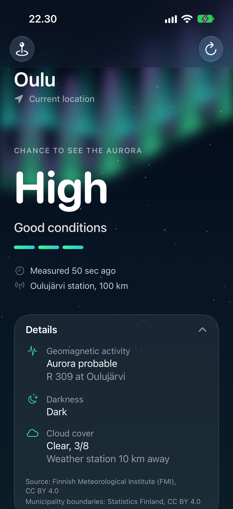
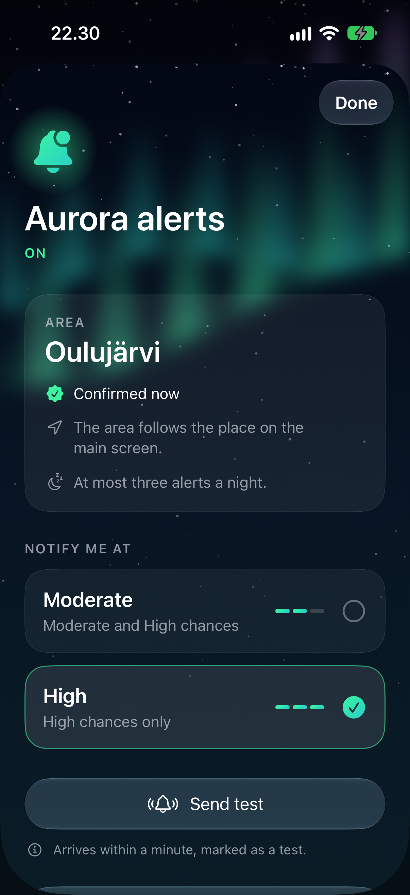

<p align="center">
  
</p>

# Revontulet

Revontulet ("northern lights" in Finnish) is a native iOS app that shows the chance of seeing the
aurora borealis at your location in Finland.

The app computes FMI's R value, a measure of geomagnetic activity, on the device from the
Finnish Meteorological Institute's open magnetometer data. It classifies the value with FMI's
per-station thresholds, the same way [fmi.fi](https://www.ilmatieteenlaitos.fi/revontulet-ja-avaruussaa)
does, and combines it with darkness and cloud cover. The result is one of four levels (None, Low,
Moderate, High) with a short reason, such as "Low – overcast". The main screen also shows your
location, the nearest measurement station and how recent the data is.

The chance also accounts for the moon: a bright moon, like twilight, lowers it by one step. The
moon's position and phase are computed on the device.

Two forecasts sit under the measurement and are marked as forecasts:

- **Soon**: whether activity is likely to rise in the next hour, from the solar wind measured
  between the Sun and Earth (NOAA's propagated solar wind), with NOAA's modelled arrival time.
- **Tonight and tomorrow night**: an outlook from NOAA's Kp forecast and geomagnetic storm
  watches, combined with each night's darkness, moon and FMI's cloud forecast.

Optional aurora alerts send a notification when the chance in your area of Finland reaches the
level you choose, even when the app is closed. See [Aurora alerts](#aurora-alerts).

<p align="center">
  
</p>

<p align="center"><sub>The main screen in Oulu during strong geomagnetic activity. The data in this
screenshot is synthetic.</sub></p>

> **Status:** version 2.0, with the aurora main screen and aurora alerts, is on the App Store.
> Version 3.0 adds the moon, the "soon" line and the two-night outlook and is in development.
> See [specs/001-aurora-main-screen](specs/001-aurora-main-screen/),
> [specs/002-aurora-alerts](specs/002-aurora-alerts/) and
> [specs/003-aurora-outlook](specs/003-aurora-outlook/).

## Principles

- **Open data only.** Science data comes from FMI open data and Statistics Finland (CC BY 4.0).
  There is no paid or scraped source. The app needs no backend; the only server is the optional
  alert service, which uses the same open data.
- **Privacy by design.** Your location stays on the device. Network requests for the main screen
  cover all of Finland and contain nothing derived from you. If you deny location access, you can
  pick a municipality by hand. No analytics, no tracking, no accounts. Alerts are opt-in and send
  only a coarse area (see below).
- **Shared core, native shells.** All domain logic lives in the portable Swift package
  `AuroraCore`, which builds without Apple-only frameworks so that an Android version can follow.
  The SwiftUI app is a thin shell.
- **Languages.** Finnish, Swedish and English.

The full set of rules is in the [project constitution](.specify/memory/constitution.md).

## Repository layout

| Path | Contents |
|---|---|
| `Packages/AuroraCore` | Swift package with fetching, parsing, R calculation, chance rules, sun and moon position, station selection, place resolution, the "soon" signal, the outlook and caching |
| `Revontulet` | SwiftUI iOS app |
| `RevontuletTests` | App unit tests, such as the check that every notification text exists in fi, sv and en |
| `RevontuletUITests` | UI tests that run against a stubbed HTTP client and a stubbed alert service |
| `Server` | The alert service: a Swift package (Hummingbird, APNs, SQLite) that runs in Docker on Linux |
| `tools` | Python scripts that regenerate bundled municipality data, record test fixtures and calibrate the forecast thresholds |
| `specs` | Feature specifications, plans and task lists (Spec Kit) |
| `project.yml` | XcodeGen project definition |

## Requirements

- macOS with Xcode 27.1 (Swift 6.4)
- iOS 26 or later (iPhone)
- [XcodeGen](https://github.com/yonaskolb/XcodeGen)
- Python 3, only for the scripts in `tools`
- Docker, only to build the alert service image

## Getting started

The Xcode project is generated from `project.yml` and is not committed. Change build settings in
`project.yml`, not in Xcode.

```sh
xcodegen generate
open Revontulet.xcodeproj
```

Run the core tests without the app:

```sh
cd Packages/AuroraCore
swift build
swift test
```

Run the UI tests:

```sh
xcodebuild test -project Revontulet.xcodeproj -scheme Revontulet \
  -destination 'platform=iOS Simulator,name=iPhone 16'
```

TestFlight builds come from Xcode Cloud. `ci_scripts/ci_post_clone.sh` installs XcodeGen,
generates the project, and sets the build number from `CI_BUILD_NUMBER`.

For the full validation steps, see the quickstarts for the
[main screen](specs/001-aurora-main-screen/quickstart.md) and
[alerts](specs/002-aurora-alerts/quickstart.md).

## Aurora alerts

Alerts are off until you turn them on in the app (the bell on the main screen). The alert
service, in `Server/`, evaluates every zone of Finland every 5 minutes with the same rules as the
app, from the shared `AuroraCore` package. When a zone's chance reaches a registered threshold
after dark, it sends a push notification through Apple Push Notification service (APNs). Each
zone gets at most three alerts a night. The notification carries only text keys and the station
name; the phone shows the text in its own language. In the settings you can send yourself a test
notification.

<p align="center">
  
</p>

### What the service keeps

- An anonymous push token for the iPhone, one zone out of about ten (the area where one
  magnetometer station is the nearest), the threshold and the day it was last confirmed.
- Nothing else: no location, municipality, language, IP address or device details, and no logs
  of requests.
- Turning alerts off deletes the registration at once. Registrations not confirmed for 180 days
  are deleted automatically. A nightly backup copy is kept for one day.

The service runs on a server in Finland. The full text is in the
[privacy policy](https://juusimaa.github.io/revontulet/privacy).

### Running the service locally

The service needs an APNs key (`.p8`) from the Apple Developer account, converted to PEM:

```sh
openssl pkcs8 -nocrypt -in AuthKey_ABC123DEFG.p8 -out AuthKey.pem
```

Run the tests, then start a development instance that sends through the APNs sandbox:

```sh
swift test --package-path Server

APNS_KEY_ID=ABC123DEFG APNS_TEAM_ID=TEAM123456 APNS_KEY_PATH=$PWD/AuthKey.pem \
APNS_TOPIC=fi.juusimaa.revontulet APNS_ENVIRONMENT=sandbox DATABASE_PATH=/tmp/alerts.db \
swift run --package-path Server alert-service
```

Or build and run the same image as production:

```sh
docker build -f Server/Dockerfile -t revontulet-alerts .
docker run --rm -p 8080:8080 \
  -e APNS_KEY_ID=ABC123DEFG -e APNS_TEAM_ID=TEAM123456 -e APNS_TOPIC=fi.juusimaa.revontulet \
  -e APNS_ENVIRONMENT=sandbox -e APNS_KEY_PATH=/run/secrets/apns_key -e DATABASE_PATH=/data/alerts.db \
  -v "$PWD/AuthKey.pem":/run/secrets/apns_key:ro -v /tmp/alerts:/data revontulet-alerts
```

The service listens on port 8080 (`PORT`). Debug builds of the app use
`http://localhost:8080/v1`; Release builds use the production instance. `curl
localhost:8080/v1/health` answers `{"status":"ok"}` once the first evaluation cycle has
succeeded. The API is described in
[contracts/alert-api.md](specs/002-aurora-alerts/contracts/alert-api.md), and deployment files
are in `Server/deploy/`.

## Data sources

- [FMI open data](https://en.ilmatieteenlaitos.fi/open-data): magnetometer and weather
  observations, CC BY 4.0
- [Statistics Finland](https://stat.fi/): municipality boundaries, CC BY 4.0
- [NOAA Space Weather Prediction Center](https://www.swpc.noaa.gov/): propagated solar wind, Kp
  forecast and geomagnetic storm watches; public domain (US government work). No NOAA or NWS
  logo is used, and no endorsement is implied.
- Calibration only, not used by the app: [NASA OMNI](https://omniweb.gsfc.nasa.gov/) 1-minute
  solar wind (public domain), [GFZ Potsdam Kp](https://kp.gfz.de/) (CC BY 4.0) and
  [JPL Horizons](https://ssd.jpl.nasa.gov/horizons/) moon positions (public domain).

## License

[GNU Affero General Public License v3.0](LICENSE)
